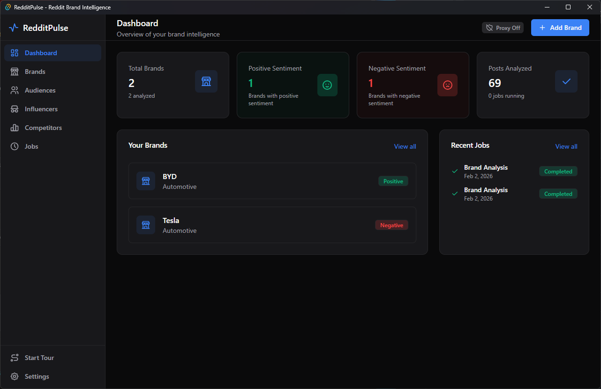

# RedditPulse — Reddit Brand Intelligence

> Monitor your brand on Reddit. AI-powered sentiment analysis, influencer discovery, competitor tracking, and audience building — all in a fast, private desktop app.

[](LICENSE)


RedditPulse is a desktop app for marketers, founders, and brand teams who want to know what Reddit says about their brand and their competitors. It finds brand mentions on Reddit through the Serper search API, scrapes the posts and comments, and scores them with OpenAI or Anthropic models. Everything runs locally: results, settings, and your own API keys are stored in a SQLite database on your machine, and the app talks only to Reddit, Serper, and the AI provider you pick (plus httpbin.org when you test a proxy).



## Features

- **Brand Monitoring** — Track multiple brands across Reddit with industry categorization
- **AI Sentiment Analysis** — GPT-5.1 or Claude Sonnet 4 powered sentiment scoring, theme extraction, and recommendations
- **Reddit Search** — Find brand mentions via Serper API with configurable limits (10–200 mentions)
- **Influencer Discovery** — Identify high-karma Reddit users with tier classification (Mega, Macro, Micro, Nano)
- **Competitor Tracking** — Compare sentiment across competing brands
- **Audience Building** — Create panels from Reddit users for targeting
- **AI Autofill** — Draft a brand's details from its name, or an audience segment for a brand
- **Background Jobs** — Async processing with real-time progress tracking and cancellation
- **Data Export** — CSV export for analyses, influencers, audiences, and a brands summary
- **Proxy Support** — HTTP, HTTPS, and SOCKS5 with authentication

## Tech Stack

| Layer | Technologies |
|-------|-------------|
| Frontend | React 19, TypeScript, Vite 7, TailwindCSS 4, Radix UI, Zustand, Recharts |
| Backend | Rust, Tauri 2, SQLite (rusqlite), Tokio, Reqwest |
| AI | OpenAI (GPT-5.1), Anthropic (Claude Sonnet 4) — switchable in settings |
| Search | Serper (Google Search API) |

## Prerequisites

- [Node.js](https://nodejs.org/) (LTS recommended)
- [Rust](https://www.rust-lang.org/tools/install)
- [Tauri prerequisites](https://v2.tauri.app/start/prerequisites/) for your platform

## Getting Started

```bash
# Clone the repository
git clone https://github.com/newmachinesph/RedditPulse.git
cd RedditPulse

# Install dependencies
npm install

# Run the desktop app in development mode
npm run tauri dev

# Build for production (creates installer)
npm run tauri build
```

Production installers are output to `src-tauri/target/release/bundle/`. The bundle targets configured in `src-tauri/tauri.conf.json` are Windows MSI and NSIS installers.

### Scripts

| Command | What it does |
|---------|--------------|
| `npm run dev` | Vite dev server for the frontend only (port 1420) |
| `npm run build` | Type-check with `tsc` and build the frontend to `dist/` |
| `npm run preview` | Preview the built frontend |
| `npm run tauri dev` | Run the full desktop app with hot reload |
| `npm run tauri build` / `npm run build:installer` | Build the desktop app and installers |

There are no test or lint scripts yet.

## Configuration

After launching, go to **Settings** to configure:

| Setting | Required | Description |
|---------|----------|-------------|
| Serper API Key | Yes | Reddit search — get one at [serper.dev](https://serper.dev) |
| OpenAI API Key | Yes* | Sentiment analysis with GPT-5.1 |
| Claude API Key | Yes* | Alternative AI provider |
| Proxy | No | HTTP/SOCKS5 proxy for scraping |

\* At least one AI provider key is required.

Settings, brands, analyses, and jobs are stored in a local SQLite database at `<local data dir>/redditpulse/data.db` (on Windows, `%LOCALAPPDATA%\redditpulse\data.db`). Nothing is sent to a RedditPulse server; there isn't one.

## Project Structure

```
RedditPulse/
├── src/                     # Frontend (React + TypeScript)
│   ├── components/          # UI components (charts, layout, ui)
│   ├── lib/                 # Stores, types, utilities
│   └── pages/               # App pages (dashboard, brands, etc.)
├── public/                  # Static assets and README screenshot
├── src-tauri/               # Backend (Rust + Tauri)
│   ├── icons/               # App icons
│   ├── tauri.conf.json      # Window, CSP, and bundle config
│   └── src/
│       ├── analysis/        # OpenAI & Claude integration
│       ├── background/      # Async job system
│       ├── commands/        # Tauri command handlers
│       ├── db/              # SQLite database layer
│       ├── models/          # Data models
│       ├── proxy/           # Proxy support
│       ├── scraper/         # Reddit scraper
│       └── serper/          # Serper API client
├── vite.config.ts
└── package.json
```

## How It Works

1. **Add a brand** to track
2. **Run analysis** — searches Reddit via Serper, scrapes posts/comments, and analyzes with GPT-5.1 or Claude Sonnet 4 as a background job
3. **View results** — sentiment score, themes, mention-level analysis, and recommendations
4. **Discover influencers** from analyzed mentions
5. **Build audience panels** from discovered users
6. **Export** any data to CSV

## Contributing

Contributions are welcome! Please open an issue first to discuss what you'd like to change.

1. Fork the repository
2. Create your feature branch (`git checkout -b feature/amazing-feature`)
3. Commit your changes (`git commit -m 'Add amazing feature'`)
4. Push to the branch (`git push origin feature/amazing-feature`)
5. Open a Pull Request

## License

This project is licensed under the MIT License — see the [LICENSE](LICENSE) file for details.

The MIT license covers the code. The RedditPulse name and logo identify the project.
